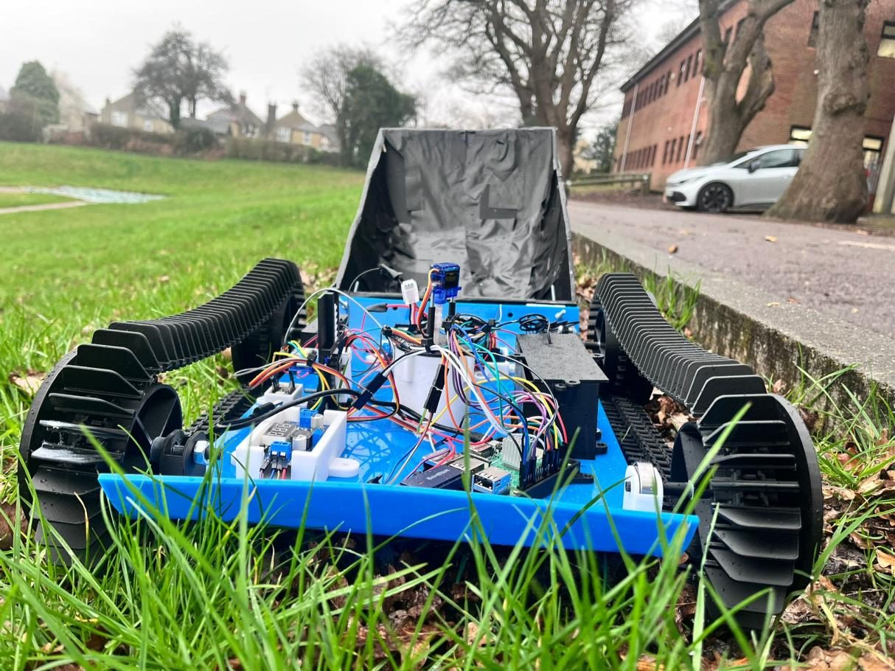
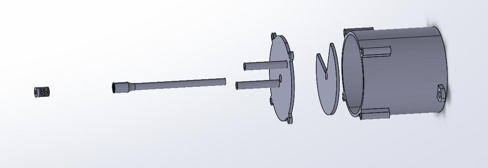

# Seed-planting robot

A tank-tread robot that tests the soil, plants seed and waters it, built for my A-level Product Design NEA (2025–26). It runs on a Raspberry Pi 3B, and all of its control code is written in Python.



## The problem

Many school fields are dry and patchy, and reseeding them is slow manual work or needs a tractor. My client was a chemistry teacher who leads his school's eco committee. He wanted an automated product that cuts out manual work, checks the soil and can be used by a secondary school student. In a survey of 19 students from different schools, about two thirds said their school lacked plant biodiversity.

## What the robot does

The robot drives on 3D-printed tank treads, steered from a wireless controller. At each spot, three modules on a laser-cut acrylic base run in turn:

| Step | Module | How it works |
| --- | --- | --- |
| 1 | Soil moisture | A servo drives a rack and pinion that pushes a capacitive soil moisture sensor into the ground. A 16-bit ADC turns its analogue reading into a value the Pi can read. |
| 2 | Seeding | A second servo turns a slotted disc under the seed hopper to drop seed onto the tested spot. |
| 3 | Watering | A 12 V submersible pump in a printed PETG tank waters the seed. It is switched through an L298N motor driver. |

| Moisture module | Seed dispenser (CAD) | Water tank (CAD) |
| --- | --- | --- |
|  |  |  |

### Hardware

| Part | Qty | Job |
| --- | --- | --- |
| Raspberry Pi 3B | 1 | Runs the control program and reads the controller |
| L298N motor driver | 2 | One for the two DC motors, one for the water pump (GPIO + PWM) |
| 16-bit ADC (I2C) | 1 | Reads the analogue soil moisture sensor |
| DC step-down buck converter | 1 | Drops the battery voltage to a safe level for the servos |
| DC motor | 2 | Drive the tank-tread sprockets (rear-wheel drive) |
| Capacitive soil moisture sensor | 1 | Measures soil moisture |
| Servo motor | 2 | Move the moisture sensor and turn the seed dispenser |
| 12 V submersible water pump | 1 | Waters the seed |

The electronics cost about £90–100 in total. The body is a laser-cut acrylic base with 3D-printed enclosures, sprockets and treads, under a hinged overhead cover.


## AI capability: finding where to plant

The robot is designed to have an automatic mode that uses a machine-learning model to tell the user where to plant. The model is an image classifier with two classes, **low plant density** and **high plant density**. It runs on camera frames of the ground, so the robot can point out bare patches that need seed and skip areas that are already growing well.

I built the network with **TensorFlow Lite** to test that a model like this can run on the Raspberry Pi. It is not trained yet. A reliable model needs about 100–200 labelled photos of high- and low-density grass, and gathering them did not fit in the NEA timeline. So the robot was finished as a minimum viable product with manual control first. Training the model and adding the automatic mode is the next step.

## Code iterations

The code is in [`code/`](code/). It was written iteratively: each file is a complete version of the program, and **the numbers run in chronological order**. `test.py` is the first version and each higher number is the next one. There are about 22 iterations in all. Before and alongside the main program, I tested single components with small scripts (`Servotest`, `Servodrop`, `servotest2`).

How the program grew across the versions:

1. **Component tests:** each servo, the motors and the pump on its own, following the original plan.
2. **Soil sensor setup:** the ADC is configured over I2C (`smbus2`, config `0xC183`), and raw counts are converted to a voltage and then a moisture value. A `try` block returns `None` on a failed read to make faults easier to trace.
3. **Pin map and servo limits:** every GPIO pin is named once, and each servo's duty cycles are set as editable limits.
4. **Controller input:** a `SeedPlantingRobot` class holds the hardware state, detects the wireless controller's USB dongle and maps its buttons to motor and servo routines (`pygame`). An ESC listener stops the program during testing.
5. **Fixes from testing:**
   - The servos jittered, so PWM now runs only while a button is held.
   - The moisture servo's duty cycles were flipped because the servo was mounted the other way round.
   - The pump's direction was reversed by flipping the value sent through its motor driver.
6. **Final version:** it starts when the Pi boots (`evdev`) and shuts down cleanly, stopping PWM and running `GPIO.cleanup()`.

<!-- iteration table: run `python3 tools/list_iterations.py code` after copying the code in, and paste its output here -->

Main libraries: `RPi.GPIO`, `smbus2`, `pygame`, `evdev`, `time`.

## Testing and what I would change

The three modules worked in testing: the soil probe, the seed dispenser and the pump all ran from the controller. Testing also showed what to improve next:

- **Drive:** the two rear motors were too weak to move the treads on grass, and the chain slipped off the sprockets. The fix is four-motor (all-wheel) drive, with smaller hand-soldered H-bridges to save space.
- **Seeding:** the rotating disc released too much seed at first and then less over time. A linear (sliding) gate would drop a steady amount.
- **Watering:** the pump stops drawing once the water falls below it. A pipe to the bottom of the tank fixes this.
- **Moisture probe:** when idle, it sits close to tread level and could snap. A thinner gear would raise it higher.
- **Cover:** my client suggested a glossy white finish instead of matt black, which would reflect heat and keep the electronics cooler.

In an end-of-project survey of 44 people, 52% said they would want their school to buy a robot like this.

## Repository layout

```text
code/          Python programs from the USB, in numbered order
docs/images/   Photos and CAD renders from the NEA portfolio
tools/         Helper script that lists the code iterations in order
```

## Author

Ishanth Reddy Thangella, A-level Product Design NEA, 2026.
