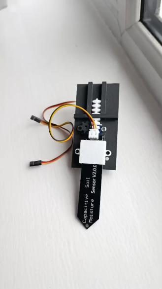
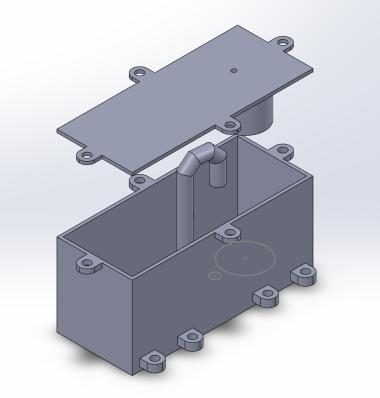
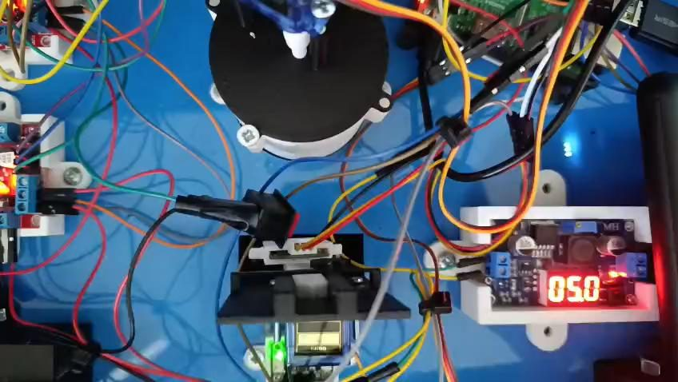

# Seed-planting robot

A tank-tread robot that tests the soil, plants seed and waters it, built for my A-level Product Design NEA (2025–26). It runs on a Raspberry Pi 3B, and all of its control code is written in Python.


## The problem

Many school fields are dry and patchy, and reseeding them is slow manual work or needs a tractor. My client was a chemistry teacher who leads his school's eco committee. He wanted an automated product that cuts out manual work, checks the soil and can be used by a secondary school student. In a survey of 19 students from different schools, about two thirds said their school lacked plant biodiversity.

## What the robot does

The robot drives on 3D-printed tank treads, steered from a wireless game controller. At each spot, three modules on a laser-cut acrylic base do the work:

| Module | How it works |
| --- | --- |
| Soil moisture | A servo drives a rack and pinion that pushes a capacitive soil moisture sensor into the ground. An ADS1115 16-bit ADC turns the sensor's analogue output into a reading the Pi can use. |
| Seeding | A second servo turns the dispenser under the seed hopper to drop seed. |
| Watering | A 12 V submersible pump in a printed PETG tank waters the seed. It is switched through an L298N motor driver. |

| Moisture module | Seed dispenser (CAD) | Water tank (CAD) |
| --- | --- | --- |
|  |  |  |

### Controls (final program, `code/test22.py`)

| Input | Action |
| --- | --- |
| Left stick up/down | Left track forwards/backwards (speed follows the stick) |
| Right stick up/down | Right track forwards/backwards |
| A | Moisture routine: lower the probe, take a reading, raise the probe |
| B | Seed drop |
| Button 3 (X on the GameSir controller used) | Water for 1 second |
| Esc on a USB keyboard | Stop everything and shut down safely |

### Hardware

| Part | Qty | Job |
| --- | --- | --- |
| Raspberry Pi 3B | 1 | Runs the control program and reads the controller |
| L298N motor driver | 2 | Driver 1 runs the water pump and the left motor, driver 2 runs the right motor (direction pins + PWM speed) |
| ADS1115 16-bit ADC (I2C, address `0x48`) | 1 | Reads the analogue soil moisture sensor |
| DC step-down buck converter | 1 | Drops the battery voltage to a safe level for the servos |
| DC motor | 2 | Drive the tank-tread sprockets (rear-wheel drive) |
| Capacitive soil moisture sensor | 1 | Measures soil moisture |
| Servo motor | 2 | Move the moisture probe and the seed dispenser (the code keeps a third servo channel spare) |
| 12 V submersible water pump | 1 | Waters the seed |

The electronics cost about £90–100 in total. The body is a laser-cut acrylic base with 3D-printed enclosures, sprockets and treads, under a hinged overhead cover.



## AI capability: finding where to plant

The robot is designed to have an automatic mode that tells the user where to plant. A camera image of the ground goes through an image model that sorts it into **low plant density** (bare or patchy grass, so plant seed here) or **high plant density** (healthy grass, so move on).

To check that a model like this can run on a Raspberry Pi 3B, I tested two small, pretrained TensorFlow Lite models, both in [`models/`](models/):

| File | Model | Notes |
| --- | --- | --- |
| `efficientdet_lite0.tflite` | EfficientDet-Lite0 | Object detector, 320 × 320 input, Apache 2.0 licence (in its metadata) |
| `yolo-fastest-uint8.tflite` | YOLO-Fastest, 8-bit quantised | Very small object detector (1.3 MB), built for low-power boards |

Both are general object detectors trained on everyday objects such as people and cars, so they do not know about grass yet. The next step is to retrain one of them on my own labelled photos of high- and low-density grass. That needs about 100–200 photos, which did not fit into the NEA timeline, so the robot was finished as a minimum viable product with manual control first. The automatic mode is not part of the control code yet.

## Code iterations

All the code is in [`code/`](code/). I built it iteratively: each file is a complete program, and **the numbers run in chronological order**, from `test.py` (version 1) to `test22.py` (version 22, the final program). The folder listing in my NEA portfolio dates versions 1–20 to 28 February – 1 March 2026.

Before the numbered versions, I wrote early prototypes ([`code/early-prototypes/`](code/early-prototypes/)), and I also tested single parts on their own ([`code/component-tests/`](code/component-tests/)).

### Early prototypes

| File | What it added |
| --- | --- |
| `Keyboard_control_test.py` | First drive test: W/A/S/D on a keyboard switches the motor driver pins on and off |
| `Keyboard_control_test_2.py` | PWM speed control, the moisture and seed servos, and the first moisture routine (probe down, read the ADS1115, choose the seed servo position, probe up) |
| `Control_test.py` | Switched to a game controller: tank drive on the two sticks with analogue speed, triggers move the servos, the controller is found automatically |
| `Control_test_2.py` | Water pump added on its own driver channel, buttons remapped (A moisture, B pump, X third servo) |

### Component tests

| File | What it tests |
| --- | --- |
| `Servotest.py` | One servo through centre, left and right using `pigpio` pulse widths |
| `Servodrop.py` | Two servos held at fixed pulse widths, with a clamp to keep pulses in a safe range |
| `servotest2.py` | All three servos driven from the controller's triggers and X button with `pygame` |

### Main versions

| Version | File | What changed |
| --- | --- | --- |
| 1 | `test.py` | Rewired for two motor drivers: driver 1 runs the pump and one motor, driver 2 the other motor. B now runs the pump while held |
| 2 | `test2.py` | Swapped the two motors' pins to match the final wiring |
| 3 | `test3.py` | Finds the controller by name, and runs a start-up self-test of every motor, servo and the pump |
| 4 | `test4.py` | Full rewrite as a `SeedPlantingRobot` class using `pygame`, with a component test, speed control on the triggers, dry/moist/wet moisture levels and an Esc key to stop |
| 5 | `test5.py` | True tank drive (one stick per track), and the three routines: moisture reading, seed cycle and 1-second watering |
| 6 | `test6.py` | Esc is read straight from the keyboard with `evdev`, so it works without a desktop. Bigger stick dead zone (0.2) for the GameSir controller |
| 7 | `test7.py` | Fixed the right stick, which is axis 3 on this controller |
| 8 | `test8.py` | Tried hardware-timed servo pulses with `pigpio` to stop servo jitter |
| 9 | `test9.py` | Back to `RPi.GPIO`, with a new jitter fix: send the servo pulse for 0.3 s, then switch the signal off |
| 10 | `test10.py` | Tidied the servos into pin + PWM pairs |
| 11 | `test11.py` | `pigpio` servos again, switching the pulse off after each move |
| 12 | `test12.py` | Fixed a bug where the left motor's enable pin was never set up, and cut the controls down to seed and water while testing |
| 13 | `test13.py` | Servos on `RPi.GPIO`, with pulse widths in microseconds converted to duty cycles |
| 14 | `test14.py` | `pigpio` servos set up cleanly at start (outputs, signal off) |
| 15 | `test15.py` | `pigpio` servos that hold their position, centred at start-up |
| 16 | `test16.py` | Settled on the `RPi.GPIO` pulse-then-off servo method for good. Moisture routine and component test back in |
| 17 | `test17.py` | Fixed the button layout: A moisture, B seed, X water |
| 18 | `test18.py` | Moved water to button 3 to match the controller's real X button, and removed the start-up test |
| 19 | `test19.py` | Takes the moisture reading only after the probe is down, with a 0.5 s settling delay, and reports whether the sensor was found |
| 20 | `test20.py` | Separate bench test: typed commands, the pump and servos through `pigpio`, and the ADS1115 read directly over I2C with `smbus2` (config `0xC183`, ±4.096 V) |
| 21 | `test21.py` | Cleaned-up bench test: fixed a duplicate moisture function left in version 20 |
| 22 | `test22.py` | **Final program:** the controller program from version 19 with the direct `smbus2` ADS1115 reading from version 21, which also prints the reading as a voltage |

The biggest problem across the versions was **servo jitter**. Software PWM on the Pi made the servos twitch while holding a position. Versions 8–16 tried hardware-timed `pigpio` pulses and several software methods, and the fix that stuck was to send the pulse just long enough for the move (0.3 s) and then switch the signal off.

### Running it

On a Raspberry Pi with the hardware connected, install the libraries the final program imports (`RPi.GPIO`, `pygame`, `evdev` and `smbus2`), then run:

```bash
python3 code/test22.py
```

Earlier versions also use `adafruit-circuitpython-ads1x15`, and the `pigpio` versions need the daemon running first (`sudo pigpiod`). Reading the keyboard for the Esc key may need `sudo`.

## Testing and what I would change

The three modules worked in testing: the soil probe, the seed dispenser and the pump all ran from the controller. Testing also showed what to improve next:

- **Drive:** the two rear motors were too weak to move the treads on grass, and the chain slipped off the sprockets. The fix is four-motor (all-wheel) drive, with smaller hand-soldered H-bridges to save space.
- **Seeding:** the rotating dispenser released too much seed at first and then less over time. A linear (sliding) gate would drop a steady amount.
- **Watering:** the pump stops drawing once the water falls below it. A pipe to the bottom of the tank fixes this.
- **Moisture probe:** when idle, it sits close to tread level and could snap. A thinner gear would raise it higher.
- **Cover:** my client suggested a glossy white finish instead of matt black, which would reflect heat and keep the electronics cooler.

In an end-of-project survey of 44 people, 52% said they would want their school to buy a robot like this.

## Repository layout

```text
code/                    Main versions test.py … test22.py (chronological)
code/early-prototypes/   Keyboard and first controller programs
code/component-tests/    Single-servo tests
models/                  Pretrained TensorFlow Lite models tested for the AI mode
docs/images/             Photos and CAD renders from the NEA portfolio
```

## Author

Ishanth Reddy Thangella, A-level Product Design NEA, 2026.
